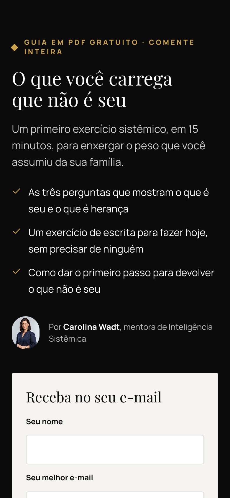

<div align="center">

# Mulher Inteira

**O novo site da Mentoria da Mulher Inteira, de Carolina Wadt.**
Páginas de vendas que falam com a mulher bem resolvida, convertem no celular e começam, enfim, a construir uma lista de e-mails própria.

React 19 · Tailwind CSS 4 · shadcn/ui · TypeScript · Vite


</div>

---

## Antes e depois, lado a lado

Este projeto não é só uma proposta em slides. Ele **replica fielmente** o que a Carol tem no ar hoje e **roda a versão melhorada ao lado**, com um clique para alternar entre as duas.

| Hoje | Proposta |
|---|---|
|  |  |
|  |  |

Na proposta, notas amarelas explicam **por que** cada coisa mudou. Um botão as esconde para ver a página limpa, como ficaria publicada.

São **dois produtos distintos**, e cada proposta respeita o seu:

- **Site oficial** (carolinawadt.com): página de vendas com preço cheio. A proposta **mantém a identidade dele** (azul-marinho, dourado e turquesa, Playfair e Inter, as pinturas dos pilares e dos resultados) e melhora a apresentação seção por seção.
- **Página Black** ("Black Outubro"): promoção de Black Friday, com preço menor, prazo e checkout próprio. Tem identidade própria, editorial em preto e dourado.

## O que a proposta resolve

| Problema de hoje | Como fica |
|---|---|
| Capa do site sem mostrar o produto nem a Carol; selos genéricos ("Compra Segura") | Slogan em letras grandes, foto da Carol e os benefícios da mentoria; selos de segurança junto do preço |
| Dores, "para quem é" e "não é para quem" só com texto e ícones repetidos | Fotos de banco e ícones próprios para a visitante se reconhecer |
| Pinturas dos pilares e resultados soltas no fundo | Molduras douradas e passe-partout, como quadros |
| "Como funciona" em quatro caixas simples | Trilha que liga quem a visitante é hoje à mulher inteira |
| Títulos misturando fontes e itálico | Uma fonte e um estilo em todos os títulos |
| Botão "Quero entrar na Mulher Inteira", com duplo sentido ao lado da foto | **"Garantir minha vaga"**, verificado por teste automático |
| "De R$1.500" riscado no site, mas o parcelado somava R$1.547,64 | O preço "de" só aparece quando é coerente. A conta é feita pelo código, não à mão |
| Garantia escondida no FAQ | Selo de 7 dias colado ao preço |
| Cliente da Europa sem caminho para pagar em euro | Link direto para a Carol, com mensagem pronta |
| Formato, horário e gravações só respondidos no WhatsApp | Seção "Cabe numa agenda cheia", com fusos de Brasília e Lisboa |
| Depoimentos como prints soltos, com emojis e sem autora | Carrossel com estrelas e nome das alunas |
| Preço ao lado de um computador, sem o que está incluso | Tudo o que a aluna recebe ao lado do preço |
| Rodapé com dois links | Rodapé completo: navegação, contatos, documentos e selos |
| Nenhuma lista de e-mails própria, dependência total do alcance do Instagram | Formulário com consentimento LGPD e RGPD e páginas de isca para o Instagram |
| Termos de Uso de consultório de psicologia | Rascunho escrito para mentoria em grupo |

**Pilares do site oficial = pilares da Black** (reunião com a Carol em 27/10). As três frentes de prosperidade ficam para o grupo avançado; nunca prometer valores.

## Iscas do Instagram, prontas para usar



A Carol quer usar a automação da Meta: "comenta INTEIRA que eu te mando". Cada isca vira uma página curta em `/isca/<nome>`:

1. A pessoa comenta a palavra no post.
2. A automação responde com o link da página.
3. Ela deixa nome e e-mail e aceita receber mensagens (com o texto do aceite registrado, como pede a LGPD).
4. Recebe o PDF, a playlist ou o vídeo.

Criar uma isca nova é acrescentar um item em [`src/content/iscas.ts`](src/content/iscas.ts). Passo a passo em [docs/captura-de-leads.md](docs/captura-de-leads.md).

<br clear="right" />

## Feito para o celular


A maior parte do público chega pelo Instagram, no telefone. Todas as páginas foram conferidas em 375, 768 e 1280 px, sem rolagem lateral. No celular, uma barra fixa mostra o preço e o botão de compra depois que a pessoa conhece o método, e some quando a oferta está na tela.

<br clear="left" />

## Rodando localmente

```bash
npm install
npm run dev
```

Abra <http://localhost:5173>. A vitrine leva a todas as páginas:

| Rota | Página |
|---|---|
| `/` | Vitrine da demonstração |
| `/atual/site` · `/atual/black` | Réplicas fiéis do que está no ar |
| `/proposta/site` · `/proposta/black` | Propostas de melhoria |
| `/isca/o-que-nao-e-seu` | Exemplo de página de isca |
| `/proposta/privacidade` · `/proposta/termos` | Rascunhos legais para mentoria |

Ou com Docker (nginx, porta 8080):

```bash
docker compose up -d --build
```

Outros comandos:

```bash
npm test                # testes de domínio e de conteúdo
npm run revisar:termos  # barra termos de duplo sentido nas propostas
npm run lint
npm run build
npm run verificar       # lint + testes + build
```

## Por dentro

O código segue Orientação a Objetos, SOLID e Clean Code, com as regras de negócio separadas da interface:

```
src/
  domain/      regras puras, sem React (Preco, Oferta, CondicaoDePagamento,
               Checkout, ContatoWhatsApp, Lead, CapturaDeLeads, IscaDigital,
               RevisorDeTermos)
  content/     todo o texto do site, tipado (atual, proposta, iscas, legal)
  features/    seções de cada página e seus hooks
  components/  shared/ (peças reutilizáveis) e ui/ (shadcn, intocado)
  app/         rotas, raiz de composição e roteador
```

- **Dinheiro em centavos.** `Preco` é um Value Object; `12 × R$128,97` dá exatamente `R$1.547,64`.
- **Inversão de dependência.** O formulário depende da interface `RepositorioDeLeads`. Hoje os dados ficam no navegador (demonstração); em produção, basta um adaptador para Brevo, MailerLite ou outra ferramenta.
- **Aberto para extensão.** Uma página é uma lista ordenada de seções. Mudar a ordem ou acrescentar uma seção não toca nas outras.
- **Conteúdo testado.** Testes garantem o botão certo, os pilares e as especialistas da Black no site e preços coerentes.

Documentação completa em [`docs/`](docs/README.md).

## Status

Demonstração para avaliação da Carol. Os campos tracejados ("data a confirmar", "preço a confirmar") dependem dela. Docker, Vercel e checklist de publicação em [docs/publicacao.md](docs/publicacao.md).

---

<div align="center">
<sub>Mentoria Mulher Inteira · Carolina Wadt · Aveiro, Portugal</sub>
</div>
